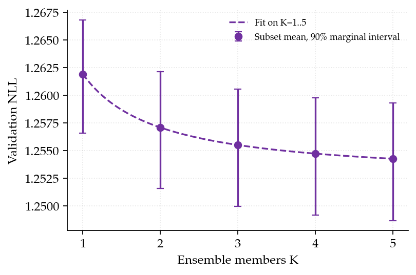
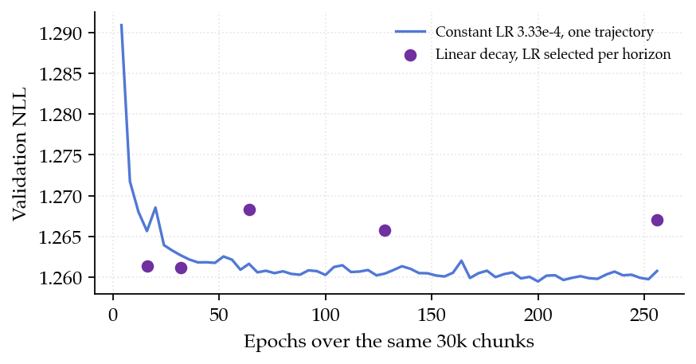
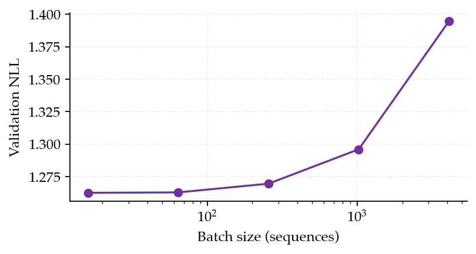
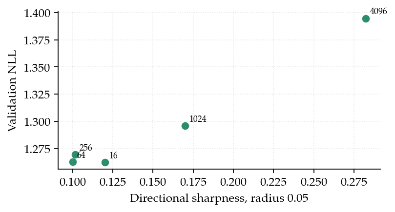
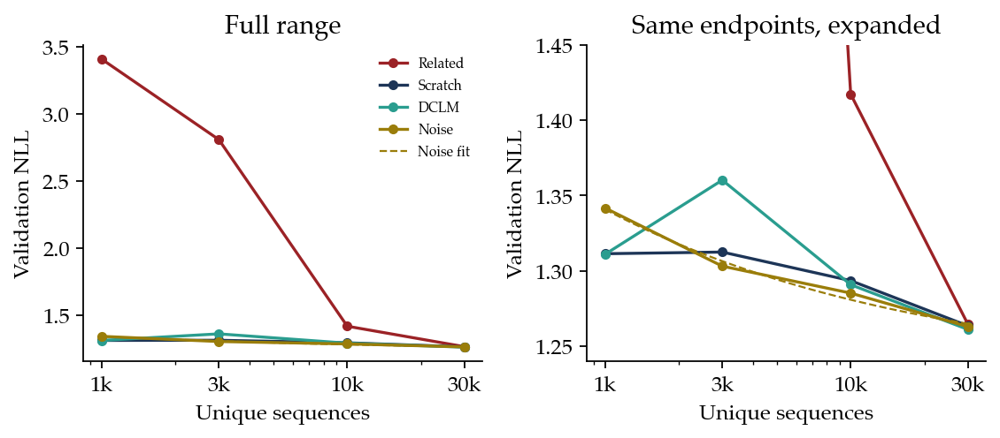

# Assignment 6: Generalization

CS312. What determines held-out loss when the unique training pool is fixed at 30,000 DNA chunks, and which interventions improve that loss per unit of extra compute, parameters, or target samples. Sections below separate measurements from fits.

**MEASURED** is a finished run or a probe on a saved checkpoint. **FITTED** is a curve fit to measured points, valid on the set it was fit on. **THEORETICAL** is a claim about the model definition, not about a loss. **PREDICTION** is a claim locked before the run that tests it. Supplied reference runs were not predicted in advance.

# Setup

The pool is 30,000 chunks of length 1,024 from the course OpenGenome2 mixture, plus a disjoint 1,000-chunk validation set. The vocabulary has 19 tokens. BOS is token 15 and is the first token of every training chunk. It is context, not a prediction target: the loss is next-token cross-entropy on positions 1 through 1,023. One pass is 30.72 million tokens. Thirty-two passes are 983.04 million tokens of exposure to the same 30,000 sequences. Repeating the pool is not new data. Chunks do not overlap, but homologous regions can still cross the split, so a lower validation NLL is generalization inside this mixture.

The default model is a dense transformer with 8 blocks, width 512, and QK normalization. It has 30,437,888 parameters. The recipe is AdamW (\(\beta=(0.9,0.95)\)), peak learning rate 0.003, weight decay 3.2, batch 64, microbatch 8, gradient clip 1, 4,800 sequences of warmup, then linear decay to zero. Dropout is off at evaluation. The supplied seed-42 run of this recipe, `0baf962ea57fafacec22`, reaches validation NLL **1.262714**. Five independent initializations at the same recipe, seeds 42–46, span **1.260806 to 1.262947**. A difference smaller than about 0.002 is inside that seed range. On the same five models, the 1,000 validation chunks have a standard deviation of about 0.10 in per-chunk NLL. Treating those chunks as independent, the standard error of the mean is **0.0032**. Homology across chunks makes that an underestimate of the uncertainty from a new draw of the validation set. A paired comparison on the same chunks can be sharper than this marginal error, but a reported move of a few thousandths is at the scale of both seed variation and evaluation error. Validation is used both to select recipes and to report them, so the selected minimum is optimistic.

A local smoke on one H100 measured 0.185 seconds per optimizer step for this dense model. The released baseline checkpoint loads into that architecture with no missing or unexpected tensors. The four-expert MoE stores 96,514,560 parameters, of which 88,080,384 are the expert pool. Top-1 routing activates one expert, so the active count is 30,454,272. Dense depth 8 has 30,437,888. The difference is 16,384 parameters, which is eight routers of shape 512×4. Counted the same way as the dense matmuls, those routers add \(9.66\times 10^{13}\) training FLOPs, 0.042% of the dense depth-8 cost \(2.289\times 10^{17}\). Active parameter count and active compute match dense depth 8. Stored count does not. The RMS+recall loop stores 11,426,688. That is exactly the parameter count of a dense depth-3 model at width 512, counted from the two built models. The loop's module list has eight entries, but the six core applications are the same block, and the boundary norm has no affine parameters. A depth-3 dense model executes three blocks. The loop executes eight. The same training-FLOP formula that reproduces the released depth-8 figure, \(2.289\times 10^{17}\) for 983.04M tokens, assigns the loop that same active cost and assigns the depth-3 model \(8.587\times 10^{16}\). The loop matches depth 8 on active compute and depth 3 on stored parameters.

# Problem 1. Architecture

## 1(a). Parameter scaling

No new training. The supplied suite is the width/depth = 64 ladder from depth 4 to depth 10: width is 64 times depth, so both axes grow together. For each shape, one recipe was selected over learning rate, weight decay, and epoch count, at model seed 42 and data-order seed 42. Every selected learning rate is 0.003. Epoch count and weight decay are not held fixed, and neither is training compute. The handout's Figure 1 also shows a DART panel. The released JSON has no DART scores, so this report does not quote any.

| Depth | Width | Parameters | Epochs | WD | Training FLOPs | Validation NLL | Run |
|---:|---:|---:|---:|---:|---:|---:|---|
| 4 | 256 | 3.81M | 32 | 1.0 | 3.48e16 | 1.269528 | `b75b98d8` |
| 5 | 320 | 7.44M | 16 | 0.8 | 3.16e16 | 1.266274 | `fbfd2167` |
| 6 | 384 | 12.85M | 32 | 3.2 | 1.04e17 | 1.262783 | `125c21fd` |
| 7 | 448 | 20.40M | 16 | 1.6 | 7.90e16 | 1.262926 | `d3bdcdaf` |
| 8 | 512 | 30.44M | 32 | 3.2 | 2.29e17 | 1.262714 | `0baf962e` |
| 9 | 576 | 43.33M | 32 | 1.0 | 3.18e17 | 1.259360 | `1843c594` |
| 10 | 640 | 59.43M | 16 | 1.0 | 2.14e17 | 1.261446 | `5e13ec06` |

**MEASURED.** The sequence of losses is not monotone in parameter count. d7 is 0.00014 worse than d6, and d10 is 0.00209 worse than d9. Both of those regressions use 16 epochs rather than 32, and d10 uses less compute than d8 or d9 (2.14e17 versus 2.29e17 and 3.18e17 FLOPs). From d4 to d6, at 32 epochs, the loss falls by 0.0067. From d6 to d9, with d8 in between, it falls by another 0.0034. Returns diminish, and the last step up in width does not pay for itself once the selected epoch budget is cut in half.

**FITTED**, on \(N\) in millions, over these seven points only:

\[
L(N) = 1.2590 + 0.02591\, N^{-0.666}.
\]

RMSE is 0.00093. Dropping d4 moves the exponent to 0.76 and the offset to 1.2593. Dropping d10 moves the exponent to 0.38 and the offset to 1.2545. The offset is a description of this curve. It sits on top of the best measured point, and it moves when one endpoint is removed. It is not a loss that any model has achieved, and it is not a prediction outside 3.8M–59M parameters.

The same comparison also says what parameter count does *not* explain. d6 and d8 differ by 17.6M parameters and by 0.00007 nats, which is far inside seed noise, while their compute differs by about 2× because both ran 32 epochs. d9, not d10, is the best model in the suite. A later architecture comparison that beats d8 by less than about 0.002 has not beaten seed variation, and a comparison that changes epoch count or weight decay at the same time has not isolated parameters.

## 1(b). Mixture of experts

New training. Four learned experts, top-1 routing, quantile balancing, weight decay 3.2, 32 epochs, seed 42, the same 30k pool. Learning rate was the only tuned variable, on the required grid \(\{0.001, 0.003, 0.01\}\). The comparison is the supplied dense depth-8 run at learning rate 0.003. Active parameters are 30,454,272 against 30,437,888, and the router term is 0.042% of dense training FLOPs. Stored parameters are 96,514,560. The prescribed score is the epoch-32 endpoint.

| LR | Validation NLL | Δ vs 1.262714 | Sharpness | Max router load CV |
|---:|---:|---:|---:|---:|
| 0.001 | 1.367250 | +0.1045 | 0.1567 | 0.243 |
| 0.003 | 1.268434 | +0.0057 | 0.0861 | 0.336 |
| 0.01 | 1.275683 | +0.0130 | 0.4110 | 0.716 |

**MEASURED.** On seed 42, learning rate 0.003 is the best of the three and finishes at 1.268434, which is 0.0057 worse than dense depth 8. That is about twice the dense seed span and about twice the 0.0032 standard error of the validation mean. Learning rate 0.01 is another 0.0073 worse and is the least balanced: its worst layer has load CV 0.716. The locked intervals for 0.003 and 0.01 both hit. The family falsifier did not fire.

Seed 43, at that same learning rate and the same data order, finishes at 1.265620. The endpoint is the best logged point on its curve. It is 0.0028 below the seed-42 MoE and 0.0029 above dense depth 8. The locked interval 1.260–1.280 hit, and the falsifier did not fire. The two MoE seeds differ by 0.0028, which is larger than the dense seed span, so the size of the deficit depends on the initialization. At epoch 20 they differed by 0.009. That gap closed, and it is not the score. The sign does not: both finishes are worse than dense depth 8. The recipe was selected on seed 42. Seed 43 is the replication, not a second search, and it is not substituted for the seed-42 result. Sharpness on seed 43 is 0.1492, against 0.0861 on seed 42, so the better of the two MoE losses is the sharper probe. Router load CV is 0.340, close to the seed-42 value 0.336.

Learning rate 0.001 is the result that the interval missed. Its logged minimum is 1.2638 at epoch 22, inside the dense seed range, and the endpoint is 1.3673. The rise is not a one-chunk fluctuation: epoch 28 is already 1.2859, and epoch 30 is 1.3333. Router load CV on the finished checkpoint is 0.243, which is better than the CV of either learning-rate 0.003 seed. Balance does not explain the collapse. The run reached the dense loss while the learning rate was still material and then gave that solution back during the decay. The 0.0057 figure is the seed-42 endpoint, which rose from 1.2644 at epoch 30. Seed 43 does not repeat that rise.

## 1(c). Looping

New training. One prelude, six applications of one shared core block, one coda, weight decay 3.2, 32 epochs, seed 42. The same three learning rates. Stored parameters are 11,426,688, the dense depth-3 count. Executed depth is 8, and the active training FLOPs match dense depth 8.

| LR | Validation NLL | Δ vs 1.262714 | Sharpness |
|---:|---:|---:|---:|
| 0.001 | 1.264715 | +0.0020 | 0.0544 |
| 0.003 | 1.264782 | +0.0021 | 0.0882 |
| 0.01 | 1.275416 | +0.0127 | 0.3936 |

**MEASURED.** The best loop on seed 42 is 1.264715, 0.0020 worse than dense depth 8. Seed 43 at the same learning rate, 0.001, finishes at 1.263934. That is 0.0012 worse than dense and 0.0008 better than seed 42. Both gaps sit inside the dense seed span, so the tie is replicated. The recipe was selected on seed 42. Seed 43 is that replication, not a second search, and it is not substituted for the seed-42 result. The shared block stores 11,426,688 parameters, 37.5% of the dense count. The 19,011,200 parameters that are not stored are 62.5% of dense depth 8. Active compute is unchanged. On seed 42, learning rates 0.001 and 0.003 differ by 0.00007, and both endpoints are the best logged points on their curves. The seed-43 endpoint is also its logged minimum. Its epoch-30 point is 1.266724, 0.0004 above epoch 28, and the last step is lower. Learning rate 0.01 is worse by 0.0127 and much sharper (0.394 against 0.054). Seed-43 sharpness at learning rate 0.001 is 0.0572, next to seed 42's 0.0544. The locked interval for seed 42 started at 1.265 and the run finished at 1.2647, a miss by 0.0003 on the boundary. The seed-43 interval [1.260, 1.272] hit. Neither family falsifier fired.

The comparison that this does *not* make is parameter-matched. Dense depth 3 has the same stored matrices and about \(8.587\times 10^{16}\) training FLOPs, roughly three-eighths of the loop. That control is 1(d).

## 1(d). Dense depth 3 at the loop's stored count

New training. Width 512 and depth 3 store 11,426,688 parameters, the same count as the six-pass loop, and execute three blocks instead of eight. Weight decay is 3.2, for 32 epochs, at seed 42. The learning-rate grid is 0.001, 0.003, and 0.01. The baseline at each learning rate is the six-pass loop.

| LR | Validation NLL | Δ vs the loop at that LR | Sharpness |
|---:|---:|---:|---:|
| 0.001 | 1.270093 | +0.0054 | 0.0687 |
| 0.003 | 1.272276 | +0.0075 | 0.0812 |
| 0.01 | 1.284576 | +0.0092 | 1.0001 |

**MEASURED.** Every endpoint is the logged minimum, and every learning rate is worse than the six-pass loop at the same learning rate. The best depth-3 run is 1.270093, 0.0054 worse than the loop and 0.0074 worse than dense depth 8. Stored parameters match the loop, so the extra executed depth is what the loop is using. Learning rate 0.001 missed [1.272, 1.330] on the low side by 0.0019. Learning rate 0.003 hit that same interval. Learning rate 0.01 finished 0.0004 below [1.285, 1.360]. The family falsifier did not fire: the best run is above 1.262 and below 1.40. The worst loss is also the sharpest, at 1.0001.

# Problem 2. Regularization

## 2(a)(i). Learning rate and weight decay at 16 epochs

No new training. The supplied grid has learning rates \(\{0.001, 0.003, 0.01\}\) and weight decays \(\{0, 0.1, 0.3, 1, 3.2, 10, 30\}\), 21 runs, all at 16 epochs, batch 64, seed 42. The quadratic is fit in centered \(\log\) LR and \(\log\) WD on the 18 positive weight decays. Zero weight decay is kept as a control and is excluded from the logarithm.

**MEASURED.** Final validation NLL on the 16-epoch grid:

| WD | LR 0.001 | LR 0.003 | LR 0.01 |
|---:|---:|---:|---:|
| 0 | 1.3426 | 1.2948 | 1.2779 |
| 0.1 | 1.3420 | 1.2886 | 1.2697 |
| 0.3 | 1.3419 | 1.2794 | 1.2621 |
| 1 | 1.2944 | 1.2632 | 1.2732 |
| 3.2 | 1.2637 | 1.2648 | 1.2802 |
| 10 | 1.2660 | 1.2783 | 1.2939 |
| 30 | 1.2770 | 1.2908 | 1.3074 |

The best cell is learning rate 0.01 and weight decay 0.3, NLL **1.262082** (`2ff5e803`). The best weight decay 0.1 cell, at the same learning rate, is **1.269724** (`59b769c9`). The best weight decay is three times 0.1, and the loss gap at that learning rate is 0.0076. The best zero-WD cell is learning rate 0.01 at **1.277873**. The three best positive cells sit near \(\mathrm{LR}\times\mathrm{WD}\approx 0.003\): (0.01, 0.3), (0.003, 1), and (0.001, 3.2), with losses 1.2621, 1.2632, and 1.2637. That local alignment is real. It is not a ranking of the whole grid. The Spearman correlation of the product with loss, over all 18 positive cells, is −0.06. A quadratic in \(\log(\mathrm{LR}\times\mathrm{WD})\) alone has RMSE 0.0112. Cells with the same product still disagree: product 0.01 gives 1.2660 at (0.001, 10) and 1.2732 at (0.01, 1).

**FITTED.** The official six-coefficient quadratic in centered log learning rate and log weight decay has RMSE 0.008594, against a loss span of 0.080. With \(u=\log\mathrm{LR}+5.774\) and \(v=\log\mathrm{WD}-0.560\),

\[
\hat L = 1.26665 - 0.007452\,u - 0.002317\,v + 0.009183\,u^2 + 0.009434\,uv + 0.002754\,v^2.
\]
 The largest residual is +0.024 at learning rate 0.001 and weight decay 0.3, where the surface is too optimistic, and −0.016 at learning rate 0.001 and weight decay 3.2, where the measured loss is better than the bowl. Residuals of this size are several times the seed range, so the surface is a summary of the valley, not a substitute for a measured cell. The critical point is a minimum, and it sits at learning rate 0.015 and weight decay 0.179, just outside the measured learning-rate grid. The surface predicts 1.2634 there. The nearest measured cell is the best cell, and that prediction is not a lower loss than 1.2621 by more than the residual. At 16 epochs a moderate weight decay beats both the old 0.1 reference and no decay. A very large weight decay is not selected at any of these learning rates.

The 32-epoch controls are a different experiment. Weight decay 0.1 ends at **1.405700** (`bd649eb7`) and weight decay 3.2 ends at **1.262714**. The gap is 0.1430 nats. The loss curve at weight decay 0.1 rises over the second half of training, which is the signature of too little decay once the same 30k chunks have been repeated, not of a universal ratio between learning rate and weight decay. The preferred weight decay on the supplied evidence is about 0.3 at 16 epochs and 3.2 at 32 epochs. Both were chosen on the validation set.

For the Hyperball comparison, the denominator is this 32-epoch gap. A method with loss \(L\) recovers the fraction \((1.405700 - L) / 0.142986\) of the benefit of moving from weight decay 0.1 to 3.2. The fraction is 1 for weight decay 3.2 and 0 for weight decay 0.1. A method worse than weight decay 0.1 has a negative fraction, which will be reported as a negative fraction rather than a percentage of a reversed ranking.

## 2(a)(ii). Hyperball

New training. Hyperball keeps every linear weight on its current Frobenius sphere: each step moves in the Adam direction and projects back to the norm from the start of that step, so the norm stays at its initial value. Embeddings, norms, and biases take a plain Adam step at \(0.104\times\) the matrix learning rate. Weight decay is 0. The learning-rate grid was \(\{0.003, 0.01, 0.03\}\), 32 epochs, seed 42, otherwise the default dense model.

| LR | Validation NLL | Δ vs 1.262714 | Fraction of the 0.1430 gap | Best logged | At epoch |
|---:|---:|---:|---:|---:|---:|
| 0.003 | 1.604059 | +0.3413 | −1.39 | 1.2719 | 6 |
| 0.01 | 1.362861 | +0.1001 | 0.300 | 1.2671 | 14 |
| 0.03 | 1.271385 | +0.0087 | 0.939 | 1.2658 | 28 |

**MEASURED.** On seed 42 the tuned run, learning rate 0.03, finishes 0.0087 worse than AdamW at weight decay 3.2 and 0.1343 better than AdamW at weight decay 0.1. It recovers 0.939 of that gap. It does not match the weight-decay 3.2 control. The 0.0087 remainder is larger than the dense seed span. The other two learning rates miss their locked intervals on the high side, and both are examples of why the endpoint is the score: learning rate 0.003 was at 1.2719 by epoch 6, reached 1.6252 at epoch 28, and ended at 1.6041. The endpoint is the prescribed score, and it is 0.021 below that logged maximum. Learning rate 0.01 was at 1.2671 by epoch 14 and ended at 1.3629. The family falsifier did not fire, because the best run is 1.2714, below the 1.350 cutoff.

Directional sharpness at radius 0.05 is 0.0905, 0.0406, and 0.0495 for those three learning rates. The flattest run is learning rate 0.01, whose loss is 1.3629. The best run is not the flattest, and the worst run is not the sharpest. The step length on the sphere is proportional to the learning rate times the frozen norm, not to the gradient norm. A small learning rate still walks, and on the linear schedule it walks away from an early good point for most of the 32 epochs. The large learning rate reaches its best point at epoch 28, when little schedule remains, and only rises by 0.0056 after that. Seed 43 at the same learning rate finishes at 1.271424, 0.00004 above seed 42, and recovers the same 0.939 of the gap. Its best logged point is 1.266788 at epoch 28, and the endpoint is 0.0046 higher, so the late rise is replicated. The interval [1.265, 1.285] hit, and the family falsifier did not fire. Sharpness on seed 43 is 0.0585, against 0.0495 on seed 42. The flatter of those two seeds is not the lower loss. The recipe was selected on seed 42. Seed 43 is that replication, not a second search. Learning rates 0.003 and 0.01 remain one seed. Hyperball can sit near the AdamW loss without a decay-to-zero penalty. At the wrong learning rate the same constraint does not stop a late rise.

## 2(b)(i). Dropout on one model

New training. Attention-probability dropout at 0.05, 0.15, and 0.25, learning rate 0.003, weight decay 3.2, 32 epochs, seed 42. Evaluation uses no dropout. The baseline is the supplied no-dropout run at 1.262714.

| Dropout | Validation NLL | Δ vs 1.262714 | Sharpness |
|---:|---:|---:|---:|
| 0.05 | 1.261245 | −0.0015 | 0.0724 |
| 0.15 | 1.261601 | −0.0011 | 0.1906 |
| 0.25 | 1.262897 | +0.0002 | 0.1607 |

**MEASURED.** All three endpoints are the best logged points on their curves, so this is not a late-rise artifact. Dropout 0.25 does have one isolated bump: 1.2879 at epoch 16, 1.3171 at epoch 18, and 1.2888 at epoch 20. It reversed inside a single logging interval, and it does not move the endpoint. That bump is at 44% of the peak learning rate. The dense baseline's epoch-12 bump is at 63%, and the SAM bump at perturbation radius 0.1 is at 69%. These are not one schedule event. Each is about 0.03, an order of magnitude above the 0.0032 standard error of the validation mean, so none of them is the noise of that mean. The losses rise slightly with the dropout rate, and every one of them sits inside the dense seed span of 1.2608–1.2629. The locked prediction that 0.25 would land in 1.270–1.310 missed on the low side. The falsifier, which required 0.25 to beat 1.262714, did not fire: 1.262897 is worse than the baseline by 0.0002.

The same 1,000 chunks support a paired comparison against the seed-42 no-dropout logits, which is sharper than the marginal standard error of 0.0032. Dropout 0.05 is 0.00147 below that checkpoint, with a 90% chunk-bootstrap interval −0.00204 to −0.00086. That gap is not an evaluation fluke. It is smaller than the distance from 1.2627 to the best no-dropout seed, 1.2608, and the 0.05 model at 1.2612 does not beat that seed. Dropout 0.15 is 0.00111 below the same checkpoint, and its interval −0.00228 to +0.00015 includes zero. Dropout 0.25 is 0.00018 above it, interval −0.00127 to +0.00180. One rate beats this particular checkpoint by a margin inside the seed span. None of the three seed-42 models beats the best no-dropout initialization, 1.260806. Sharpness is not monotone in the rate. The 0.05 model is flatter than the dense baseline (0.072 against 0.100) and the 0.15 model is sharper (0.191), with losses 0.0004 apart.

Seed 43 at dropout 0.05 finishes at 1.258402. That is 0.002843 below its seed-42 twin, with a 90% paired interval 0.002204 to 0.003546, and 0.002403 below the best no-dropout seed on the same chunks, 1.260805, with interval 0.001991 to 0.002839. Both intervals exclude zero. The endpoint is the logged minimum. The locked interval [1.255245, 1.267245] contains it. Sharpness is 0.1394, against 0.0724 on seed 42, so at this rate the lower loss is the sharper probe. The two dropout seeds, averaged as probabilities, reach 1.256048. That is 0.003776 below the mean of the two individual losses, interval 0.003553 to 0.004026, and 0.001041 below the no-dropout \(K=2\) loss of 1.257089, interval 0.000803 to 0.001286.

Seed 43 at dropout 0.15 finishes at 1.258863. That is 0.002739 below its seed-42 twin, interval 0.002124 to 0.003407, and 0.001942 below the same best no-dropout seed, interval 0.001279 to 0.002525. The endpoint is the logged minimum, and the locked interval [1.255601, 1.267601] contains it. Sharpness is 0.1315, against 0.1906 on seed 42, so at this rate the lower loss is the flatter probe. The two seeds average to 1.257571, which is 0.002661 below the mean of their individual losses, interval 0.002472 to 0.002860. The pair is 0.000482 above the no-dropout \(K=2\) loss. The 90% interval for that gap, −0.000201 to 0.001229, includes zero. Seed 43 at dropout 0.25 finishes at 1.260817, 0.002080 below its seed-42 twin. The endpoint is the logged minimum. Sharpness is 0.1615, against 0.1607 on seed 42. This rate does not beat the best no-dropout seed. The locked intervals all contain their seed-43 results, and the family falsifier did not fire: the largest move from a seed-42 twin is 0.0028, under the 0.015 cutoff. The recipe was not selected on these seeds. Each seed-43 run is the replication of that rate, and none is substituted for its seed-42 result.

Per-chunk losses of the five no-dropout seeds correlate at 0.993 to 0.997, mean 0.996. That correlation says which chunks are hard. It does not say the token predictions agree: the same five models still fall from a mean loss of 1.261927 to a probability average of 1.254255. Dropout 0.05 correlates with those five at the same level, mean 0.996. The rate that beat seed 42 does not make a more diverse member. Dropout 0.15 correlates at 0.982 and dropout 0.25 at 0.964, so a higher rate does move the chunk-level errors, and those are the rates that did not improve the individual loss. Adding each finished dropout model to the five-model probability average is the comparison in 2(b)(iii).

## 2(b)(ii). No-dropout ensembles

No new training. Five dense models, seeds 42–46, on the same 30k pool, learning rate 0.003, weight decay 3.2, 32 epochs. Their individual validation NLLs are 1.262714, 1.262947, 1.261168, 1.260806, and 1.261999. Ensembles average probabilities, then take the negative log. At each \(K\), the reported loss averages every subset of \(K\) members.

| K | Mean validation NLL |
|---:|---:|
| 1 | 1.261927 |
| 2 | 1.257089 |
| 3 | 1.255512 |
| 4 | 1.254726 |
| 5 | 1.254255 |

**MEASURED.** The paired chunk bootstrap, resampling the same 1,000 validation chunks for every \(K\), puts the \(K=1\) to \(K=5\) gain at 0.00768, with a 90% interval 0.00729–0.00808. The \(K=1\) to \(K=2\) gain is 0.00484 (0.00460–0.00510). Marginal intervals for each \(K\) are about 0.010 wide and overlap; the paired difference does not. The gain is larger than the standard deviation of the five individual losses, which is 0.0028. Most of the gain is the first added member.

**FITTED**, on \(K=1,\ldots,5\) only:

\[
L(K) = 1.25246 + 0.009465\, K^{-1.032},
\]

RMSE \(3\times 10^{-6}\) on the five means. Refitting on \(K=1,\ldots,4\) leaves the exponent at 1.032 and the offset at 1.25247. That agreement is cheap: the exponent is chosen from a grid, and three parameters on four or five smooth points land nearby. The form is not identified. \(C+A/K\) has RMSE \(1.6\times 10^{-5}\) and also evaluates to 1.2533 at \(K=10\). \(C+A K^{-1/2}\) has RMSE \(3.0\times 10^{-4}\) and offset 1.2476. \(C+A e^{-K}\) has RMSE \(1.2\times 10^{-4}\) and an offset about 0.00005 above the measured \(K=5\) loss, so on these five points it has already stopped declining. The free-exponent offset 1.2525 is 0.0018 below that loss. Evaluating the free-exponent fit at \(K=10\) gives 1.2533. None of these numbers is a measurement past \(K=5\), and the five members do not identify an infinite-ensemble floor. Training cost and inference cost both scale linearly with \(K\). The first extra member buys 0.0048 nats. The fifth member buys 0.00047.

## 2(b)(iii). One dropout model added to the no-dropout bank

**MEASURED.** Each finished seed-42 dropout model is averaged, as probabilities, with the same five no-dropout seeds. The five-model ensemble is 1.254255. Adding dropout 0.05 lowers it to 1.254087, a gain of 0.000167, with a 90% paired chunk interval 0.000113 to 0.000221. Adding dropout 0.15 lands at 1.254293, a change of −0.000038, and its interval −0.000163 to 0.000077 includes zero. Adding dropout 0.25 lands at 1.254445, a change of −0.000190, with interval −0.000350 to −0.000045. The sign follows the individual loss: the rate that beat the seed-42 checkpoint helps this ensemble, and the rate that did not hurts it. The size is about thirty times smaller than the 0.00484 gain from a second no-dropout member. The lower chunk correlation at rate 0.25 does not become a larger ensemble gain. This comparison adds one dropout model to five models trained without dropout. The same-rate pair is a different comparison. At rate 0.05 the two seeds average to 1.256048, which is 0.001041 below the no-dropout \(K=2\) loss. The members still disagree enough for a 0.003776 gain over their own average, close to the 0.00484 gain from a second no-dropout member, and the pair ends lower because both members started lower. At rate 0.15 the two seeds average to 1.257571. That pair is 0.000482 above the no-dropout \(K=2\) loss, and the paired interval includes zero. Both seed-43 rates finish below the best no-dropout seed. The flatness comparison does not travel with that improvement. Rate 0.05 is sharper on the better seed, and rate 0.15 is flatter.

# Problem 3. Optimization

## 3(a). Learning-rate schedules

No new training, and this subsection does not require a second seed. The constant-LR runs are five endpoints of one trajectory at learning rate \(3.33\times 10^{-4}\) and weight decay 3.2. Each shorter endpoint matches the long history exactly. The linear-decay runs are separate trainings. Their selected learning rates are not the same number, so a lower loss at one horizon is not a pure schedule effect.

| Epochs | Constant LR \(3.33\times10^{-4}\) | Linear decay | Linear LR |
|---:|---:|---:|---:|
| 16 | 1.265659 | 1.261350 | 0.001414 |
| 32 | 1.262673 | 1.261138 | 0.003517 |
| 64 | 1.261642 | 1.268315 | 0.01 |
| 128 | 1.260447 | 1.265813 | 0.01 |
| 256 | 1.260759 | 1.266993 | 0.01 |

**MEASURED.** At 32 epochs the selected linear run is 0.0015 below the constant trajectory. That gap is inside the seed range of the default recipe. The default linear run at learning rate 0.003 and 32 epochs is 1.262714, which matches the constant trajectory at the same horizon to three digits. Past 32 epochs the constant trajectory improves by another 0.0022 and then stalls: 1.260447 at 128 epochs and 1.260759 at 256. The linear runs at 64, 128, and 256 epochs were all selected at learning rate 0.01, and all three are worse than the constant trajectory. Continuing to repeat the same 30k chunks with a large decaying learning rate does not keep helping.

A separate epoch sweep at learning rate 0.003, not the same selection as the table above, gives 1.268735 at 8 epochs (weight decay 3.2), 1.263182 at 16 (weight decay 1.0), 1.262714 at 32 (weight decay 3.2), and 1.269079 at 64 (weight decay 3.2). Sixty-four passes are worse than thirty-two. On that 64-epoch trajectory the logged minimum is 1.264698 at epoch 56, and the endpoint 1.269079 is higher. The endpoint is the prescribed comparison. Even the epoch-56 point is worse than the 32-epoch result 1.262714. The 32-epoch curve is not smooth either: at epoch 12 it is 1.320758, up from 1.292658 at epoch 8, and the endpoint is still the minimum of its logged points. A mid-run bump of that size can reverse. Extra epochs are extra exposures of the same sequences. They are not a substitute for more unique chunks, and on this recipe they start to hurt between 32 and 64 passes.

The schedule changes how long a large step size keeps moving the weights, which could change the sharpness of the solution. No checkpoint from the constant trajectory or from the learning-rate 0.01 linear runs was released, so the probe was not applied to those schedules. Elsewhere the same probe separates flatness from loss: SAM at \(\rho=0.1\) reaches sharpness 0.0113 and is 0.0112 worse than AdamW, and batch 16 at sharpness 0.120 is tied with the flatter batch 64. Among the supplied schedule selections, the measured comparison is the loss. A small constant learning rate is the better long-horizon choice, and a linear schedule at the short-horizon learning rate matches that constant run at 32 epochs.

## 3(b). Batch size

No new training. Five runs at 32 epochs, seed 42, with learning rate and weight decay scaled by \(\sqrt{B/64}\) from the batch-64 recipe. Token exposure is the same. The number of optimizer updates is not: batch 16 takes 60,000 updates and batch 4096 takes 256.

| Batch | LR | WD | Updates | Validation NLL | Sharpness at radius 0.05 | Run |
|---:|---:|---:|---:|---:|---:|---|
| 16 | 0.0015 | 1.6 | 60,000 | 1.262385 | 0.1203 | `8f3947f2` |
| 64 | 0.003 | 3.2 | 15,008 | 1.262714 | 0.1000 | `0baf962e` |
| 256 | 0.006 | 6.4 | 3,776 | 1.269413 | 0.1016 | `f45fac8b` |
| 1024 | 0.012 | 12.8 | 960 | 1.295902 | 0.1699 | `24593767` |
| 4096 | 0.024 | 25.6 | 256 | 1.394662 | 0.2824 | `5b60be2e` |

**MEASURED.** Batch 16 is best, by 0.00033 over batch 64. That margin is much smaller than seed noise, so 16 and 64 are tied for practical purposes. From 64 to 256 the loss rises by 0.0067. From 256 to 4096 it rises by another 0.125. The damage tracks the collapse in update count and the growth of the scaled learning rate, not a smooth preference for gradient noise.

**MEASURED.** The release records sharpness for every batch except 64. The same starter probe, on the first four rows of `target_30k.npy`, run in fp32 on `checkpoints/baseline_d8_e32_s42.pt`, gives a max loss increase of **0.1000** at radius 0.05. The check on this pipeline is the batch-16 checkpoint: the same code returns 0.1208, and the release records 0.1203. Base losses on that checkpoint are 1.218190 and 1.218185. The batch-64 number is therefore the same definition, with a discrepancy of about 0.0005.

Sharpness does not rank the models the way the flat-minima story would. Batch 64, at 0.100, is as flat as batch 256, at 0.102, and 0.0067 better in validation NLL. Batch 16 is sharper, at 0.120, and tied with batch 64 on the loss. Batch 1024 and 4096 are both sharper and worse, so the large-batch failure coincides with a sharper probe, but the ordering among the three best batches does not. The probe is a directional finite difference. It is not a Hessian eigenvalue. A claim that lower sharpness produces lower DNA validation loss is false on these five points.

The same probe on the seven selected parameter-suite checkpoints gives the same negative result, and the depth-8 value matches the batch-64 measurement exactly (0.1000). Directional sharpness at radius 0.05 is 0.0416, 0.0201, 0.1227, 0.0346, 0.1000, 0.0447, and 0.0268 for depths 4 through 10. The best validation loss, depth 9 at 1.2594, is not the flattest. The flattest model is depth 5 at 0.020, and its loss is 1.2663. The sharpest model is depth 6 at 0.123, tied with depth 8 on the loss. The two weight-decay 3.2 recipes, depths 6 and 8, are the two sharpest, and the 32-epoch weight-decay 1.0 recipes, depths 4 and 9, are both near 0.04. Size does not order the probe. Weight decay might, but epoch count and width change at the same time, so that is an association in this suite rather than an isolated effect.

## 3(c). SAM versus AdamW

New training. SAM perturbs weights by \(\rho\) times the gradient direction, evaluates the gradient there, restores the weights, and takes an AdamW step. Same dense model, learning rate 0.003, weight decay 3.2, 32 epochs, seed 42. The extra backward pass makes each update about twice as expensive as AdamW. \(\rho\) was tuned on \(\{0.01, 0.05, 0.1\}\).

| \(\rho\) | Validation NLL | Δ vs 1.262714 | Sharpness |
|---:|---:|---:|---:|
| 0.01 | 1.261672 | −0.0010 | 0.0321 |
| 0.05 | 1.263153 | +0.0004 | 0.0184 |
| 0.1 | 1.273942 | +0.0112 | 0.0113 |

**MEASURED.** On seed 42, the best SAM run, \(\rho=0.01\), is 0.0010 better than AdamW. That is inside the dense seed span. \(\rho=0.05\) is a tie. \(\rho=0.1\) is 0.0112 worse, which is outside that span. All three locked intervals hit, and the family falsifier did not fire: no run moved the AdamW loss by more than 0.025. The \(\rho=0.1\) curve has the same kind of one-interval bump, 1.2999 at epoch 8, 1.3307 at epoch 10, and 1.2971 at epoch 12, and then falls to the endpoint. Sharpness falls as \(\rho\) grows, from 0.032 to 0.011, against 0.100 for the AdamW baseline. The flattest of the three is the worst. A flatter probe is not a lower validation NLL here either, and the flatness was bought with a second gradient on every step.

Seed 43 at \(\rho=0.01\), the selected radius, finishes at 1.263302. The endpoint is the best logged point. It is 0.0006 above AdamW and 0.0016 above the seed-42 SAM run, both inside the dense seed span. The locked interval 1.256–1.270 hit, and the falsifier, a move of more than 0.02 from AdamW, did not fire. The tiny seed-42 advantage over AdamW changes sign under the second initialization. The replicated comparison is a tie with AdamW. Sharpness is 0.0380, still well below the AdamW probe at 0.100, and this flatter seed is not the one with the lower loss. \(\rho=0.05\) and \(\rho=0.1\) remain single-seed results. The recipe was selected on seed 42.

## 3(d). SGD

New training. SGD with momentum 0.9, the same three learning rates as the AdamW grid, weight decay 3.2 applied inside the gradient on linear weights only, 32 epochs, seed 42. Embeddings, norms, and biases are not decayed. This is coupled decay, not AdamW's decoupled decay.

| LR | Validation NLL | Δ vs 1.262714 | Sharpness |
|---:|---:|---:|---:|
| 0.001 | 1.395819 | +0.1331 | 1.4612 |
| 0.003 | 1.392914 | +0.1302 | 2.1667 |
| 0.01 | 1.396202 | +0.1335 | 2.9386 |

**MEASURED.** The best SGD run is 1.392914, 0.1302 worse than AdamW. The three learning rates span only 0.0033, so the loss is not an accident of picking the worst of these three. Every endpoint is the logged minimum. Every locked interval hit, and the family falsifier did not fire: the best run is above 1.266 and below 1.70. Sharpness is 1.46 to 2.94, far above the AdamW probe at 0.100, and the flattest of the three is the middle loss only in the sense that all three losses agree. The grid is the AdamW grid. A learning rate outside it is not ruled out. Inside it, coupled SGD does not approach the AdamW loss.

# Problem 4. Fine-tuning

## 4(a). Full fine-tuning after one pass

New training. Four initializations, full fine-tuning, weight decay 3.2, one pass over the 30k pool, seed 42 for the scratch model and data-order seed 42 for every run. The pretrained checkpoints are fixed, so the scratch seed is not a new pretraining draw. Learning rate was tuned per initialization on \(\{10^{-4}, 3\times 10^{-4}, 10^{-3}, 3\times 10^{-3}\}\).

| Initialization | \(10^{-4}\) | \(3\times 10^{-4}\) | \(10^{-3}\) | \(3\times 10^{-3}\) |
|---|---:|---:|---:|---:|
| Related DNA | 1.2325 | **1.2291** | 1.2373 | 1.2722 |
| DCLM text, body only | 1.3068 | 1.3004 | 1.2960 | **1.2942** |
| Scratch | 1.3234 | 1.3071 | 1.2997 | **1.2981** |
| IID nucleotide noise | 1.3680 | 1.3482 | 1.3242 | **1.3219** |

**MEASURED.** After one pass, related DNA at learning rate \(3\times 10^{-4}\) reaches 1.2291. The best scratch run reaches 1.2981. The gap is 0.069, an order of magnitude past seed noise and past the 0.0032 validation standard error. Related DNA is also the only initialization whose best learning rate is interior to the grid: \(3\times 10^{-4}\) beats both neighbors. DCLM, scratch, and noise are all best at \(3\times 10^{-3}\), the top edge of the grid, so the search does not show that those three learning rates are optimal. DCLM at 1.2942 is 0.0039 better than scratch. That is about one validation standard error, and both runs sit on the edge of the grid, so one epoch does not establish a DCLM advantage. Noise at 1.3219 is 0.0238 worse than scratch. A random DNA pretraining does not transfer, and on this grid it is the worst place to start. The family falsifier did not fire: the best related run is far below 1.40, and no DCLM run beats it.

The step-0 losses, measured before any target update, change what that ranking means. Related DNA starts at 1.2576, already below the 32-epoch dense checkpoint at 1.2627 and within 0.002 of the best scratch endpoint in the release. The tuned pass then lowers it by 0.0285, to 1.2291. Learning rate 0.003 moves the same checkpoint the other way, to 1.2722. Its first logged point is still an improvement, 1.2477 at epoch 0.062, the same place the tuned learning rate is. It then spikes to 1.3212 at epoch 0.186, just after warmup, and the rest of the pass only recovers to 1.2722. One large step spends the head start after both learning rates have already shown they can improve the checkpoint. Scratch starts at 3.3739, so the related-versus-scratch gap falls from 2.116 before any update to 0.069 after one tuned pass. Almost all of that closure is scratch learning the token map, not related DNA losing its lead. DCLM starts at 6.0702, worse than a random network, because its embedding and head are a new DNA vocabulary on a text body. Its one-pass loss of 1.2942 is a recovery from that start, not a head start, and it remains within one validation standard error of scratch. Noise starts at 1.4142, well ahead of scratch, and finishes at 1.3219, behind it. A usable nucleotide embedding is not the same as a body that matches this pool.

A second data order, seed 43, at the winning one-pass learning rate replicates related DNA at 1.228450, 0.0006 below the data-order-42 result, and scratch at 1.297396, 0.0007 below its twin. DCLM moves the other way, to 1.296487, and the small one-pass edge over scratch shrinks to 0.0009. Noise moves by 0.0143, to 1.307638, and misses its interval on the low side. It is still 0.0102 worse than the scratch replicate. The related-versus-scratch gap is 0.0689 on this order. The family falsifier did not fire.

## 4(a), continued. Four passes and sixteen passes

| Initialization | Passes | Best LR | Validation NLL | Endpoint is the minimum |
|---|---:|---:|---:|---|
| Related DNA | 4 | \(10^{-4}\) | 1.228767 | no, 1.227592 at epoch 2 |
| Scratch | 4 | \(3\times 10^{-3}\) | 1.276589 | yes |
| DCLM | 4 | \(10^{-3}\) | 1.273315 | yes |
| Noise | 4 | \(10^{-3}\) | 1.280956 | yes |
| Related DNA | 16 | \(10^{-3}\) | 1.264776 | no, 1.2601 at epoch 12 |
| DCLM | 16 | \(10^{-3}\) | 1.261285 | yes |
| Noise | 16 | \(10^{-3}\) | 1.263121 | yes |
| Scratch, supplied | 16 | \(10^{-3}\) | 1.263681 | yes |

**MEASURED.** Four passes do not improve the tuned related-DNA result. The endpoint 1.228767 is 0.0003 below the one-pass result 1.229063, and the logged minimum is 1.227592 at epoch 2. The two larger related learning rates are worse, and both rose after an early point. Scratch improves from 1.298103 to 1.276589. The related-versus-scratch gap falls from 0.069 to 0.0478. DCLM at 1.273315 is 0.0033 better than scratch. The four-epoch family falsifier did not fire.

A second data order at these learning rates keeps that ranking. Related DNA finishes at 1.228823, 0.000056 above its twin, and the minimum is again at epoch 2, 1.227738. Scratch finishes at 1.276788, DCLM at 1.273460, and noise at 1.291644. The first three move by less than 0.0002. Noise moves by 0.0107 and remains 0.0149 worse than scratch. The related-versus-scratch gap is 0.0480. All four intervals hit, and this falsifier did not fire.

Sixteen passes remove the related-DNA lead. Learning rate \(10^{-4}\) reaches 1.2281 at epoch 2 and ends at 1.324141. Learning rate \(3\times 10^{-4}\) ends at 1.304134. Both climbs happen while weight decay 3.2 is still pulling the pretrained weights toward zero and the learning rate is too small to replace them. Learning rate \(10^{-3}\) is the best related run, at 1.264776. DCLM at the same learning rate finishes at 1.261285, 0.0035 better, so the locked falsifier fired: the criterion was that DCLM would not beat related. Noise finishes at 1.263121. The supplied scratch run at this learning rate and weight decay is 1.263681. At this horizon the four initializations land within about 0.004, and the one-pass gap of 0.069 is gone. The prediction is not revised.

A second data order at learning rate 0.001 finishes at 1.265161, 1.263249, 1.261844, and 1.262181 for related DNA, scratch, DCLM, and noise. Every move from its twin is under 0.001. Related DNA is again best at epoch 12, 1.259196, and the endpoint is higher. DCLM remains 0.0033 ahead of related. All four intervals hit, and this falsifier did not fire.

## 4(b). Smaller pools at the 16-pass learning rate

New training. Sixteen passes at learning rate 0.001 and weight decay 3.2, the learning rate selected on the 30k pool. The 30k cells are the runs already scored and are not retrained.

| Pool | Related | Scratch | DCLM | Noise |
|---:|---:|---:|---:|---:|
| 1,000 | 3.405294 | 1.311475 | 1.311121 | 1.341773 |
| 3,000 | 2.806183 | 1.312572 | 1.360269 | 1.303228 |
| 10,000 | 1.417181 | 1.293627 | 1.290938 | 1.285362 |
| 30,000 | 1.264776 | 1.263681 | 1.261285 | 1.263121 |

**FITTED.** Noise is the only monotone curve that a decreasing power law describes. The fit is \(L = 1.2292 + 1.1209\, n^{-0.334}\), RMSE 0.0030. The offset is a fit, not a measured floor. Related DNA also falls at every pool, from 3.405294 to 1.264776, and the same search returns RMSE 0.223. That curve is not a scaling law. Scratch and DCLM rise once, so they are not fit.

**MEASURED.** The score is the final epoch. Related DNA's early checkpoints, 1.2455, 1.2387, and 1.2524, are better than its 30k endpoint. The scored endpoints are the collapses in the table. Scratch, DCLM, and noise stay near 1.29–1.34. On the three smaller pools the related endpoint is worse than scratch, so it is not a larger scratch pool. Scratch is not monotone, 1.312572 at 3,000 against 1.311475 at 1,000, so there is no effective-sample number. The family falsifier did not fire: related at 10,000 is 1.417181, below 1.45, and the other three initializations are better at 10,000 than at 1,000. Several individual intervals missed. The predictions are not revised.

## Scratch at 16 epochs, supplied

No new training. The 16-epoch grid already contains weight decay 3.2 at learning rates 0.001, 0.003, and 0.01. Those runs start from scratch on this same 30k pool, so they are the scratch control at that horizon. They were not retrained.

| LR | Validation NLL | Run |
|---:|---:|---|
| 0.001 | 1.263681 | `ad5a6bf4e8` |
| 0.003 | 1.264844 | `cc5e09349d` |
| 0.01 | 1.280172 | `724342466b` |

**MEASURED.** The best of these three is 1.263681, at learning rate 0.001. Learning rate 0.01 is 0.0165 worse. One pass of related DNA, at 1.2291, is 0.0346 below that sixteen-pass scratch result. Depth 9 at 1.259360 is still 0.0303 higher, and the five-model ensemble at 1.2543 is 0.0252 higher. The 256-epoch constant schedule finishes at 1.260759. Those are not matched-width or matched-horizon comparisons.

## 4(c). Adapting the related-DNA checkpoint

New training. Sixteen passes at learning rate 0.001, the learning rate selected for full fine-tuning. The full run at weight decay 3.2 is the baseline, 1.264776, and it is not retrained. Freezing the body trains only the token embedding and the output head. Freezing the head trains every parameter except the output head. Decay toward initialization uses the same mask as AdamW decay, aimed at the loaded weights instead of zero.

| Adaptation | Weight decay | Validation NLL | Best logged | At epoch |
|---|---:|---:|---:|---:|
| Full, the baseline | 3.2 | 1.264776 | 1.2601 | 12 |
| Frozen head | 3.2 | 1.265271 | 1.2603 | 13 |
| Frozen body | 3.2 | 1.243429 | 1.243429 | 16 |
| Toward initialization | 3.2 | 1.308736 | 1.2359 | 7 |
| Full | 1 | 1.401846 | 1.2494 | 1 |
| Full | 0.1 | 1.644539 | 1.2420 | 1 |
| Full | 0 | 1.665846 | 1.2414 | 1 |

**MEASURED.** Less decay is worse, not better. Weight decay 0 and 0.1 reach about 1.24 at epoch 1 and end at 1.665846 and 1.644539. Weight decay 1 ends at 1.401846. At this learning rate the decay toward zero is what keeps the 30k run from climbing. Pulling toward the pretrained weights instead delays that climb: the best logged point is 1.2359 at epoch 7, and the endpoint is 1.308736. Freezing the output head matches full fine-tuning, 1.265271 against 1.264776. Freezing the body is the best run in the group, 1.243429, and the endpoint is the minimum. Its sharpness is 0.0142. The locked falsifier fired, because that run is below 1.254. The prediction said the body was the part worth training. At sixteen passes the body was the part worth leaving alone. The prediction is not revised.

## 4(d). Hyperball fine-tuning

New training. Related DNA, sixteen passes, weight decay 0, each linear weight held on the Frobenius sphere of the loaded checkpoint. The comparison is full fine-tuning at learning rate 0.001 and weight decay 3.2, loss 1.264776.

| LR | Validation NLL | Best logged | At epoch | Sharpness |
|---:|---:|---:|---:|---:|
| \(3\times 10^{-4}\) | 1.294462 | 1.2279 | 3 | 0.0482 |
| \(3\times 10^{-3}\) | 1.794142 | 1.2343 | 1 | 0.1381 |
| 0.03 | 1.268391 | 1.268391 | 16 | 0.0083 |

**MEASURED.** Learning rate 0.03 finishes at 1.268391, 0.0036 worse than full fine-tuning, and the endpoint is the minimum. The two smaller learning rates reach about 1.23 early and then climb, to 1.294462 and 1.794142. The sphere step does not shrink with the gradient, so a small learning rate keeps walking after the pretrained solution has already been improved. The family falsifier did not fire: the best run is 1.268391. The flattest probe, 0.0083, is the best of these three. That does not overturn the earlier batches, where the flattest probe was not the best loss.

# Predictive rules from the supplied runs

These rules use only the released runs. Each one names the regime it was measured in. A later trained comparison can override the corresponding row.

::: {.prose-table}
| Regime | Expected effect | Evidence | Why | Exception | Confidence |
|---|---|---|---|---|---|
| Width/depth = 64, 12.8M–30.4M parameters, 32 epochs, learning rate 0.003 | Extra parameters move validation NLL by much less than 0.003 | d6 1.262783 vs d8 1.262714 | Both recipes already sit on the flat part of the ladder; seed span is 0.002 | d4 to d6, still at 32 epochs, drops 0.0067; d9 at 43.3M and weight decay 1.0 reaches 1.25936 | high inside the band, low past 60M |
| Same 30k pool, default recipe, 32 vs 64 passes | Another 32 passes does not improve the selected 32-epoch loss | 1.262714 vs 1.269079 | The same chunks are repeated; the learning rate has already decayed | A constant learning rate of \(3.33\times 10^{-4}\) still improves by 0.0022 from 32 to 128 epochs, then stalls | high for this recipe |
| 16-epoch LR×WD grid | The best cells cluster near LR×WD ≈ 0.003; the product does not rank the other cells | Best three losses 1.2621, 1.2632, 1.2637; Spearman −0.06 | The valley is local. Equal products elsewhere disagree by 0.007 | At 32 epochs the selected weight decay is 3.2, not the 16-epoch winner 0.3 | high on this grid |
| 32 epochs, learning rate 0.003, weight decay 0.1 vs 3.2 | Too little decay costs about 0.143 | 1.405700 vs 1.262714 | The weight-decay 0.1 curve rises in the second half | Not a claim that 3.2 is optimal at every horizon; at 16 epochs, 0.3 wins | high |
| Five no-dropout seeds, probability average | Most of the ensemble gain is the second member; \(K=5\) is not an infinite-ensemble floor | \(K=1\) to \(K=2\) gain 0.00484; \(K=5\) loss 1.254255; fit offset 1.25246 | Members already agree to about 0.002, so extra copies buy little | A much worse sixth member can pull the average up | high for \(K\le 5\) |
| Batch 16–4096, square-root LR and WD scaling, 32 epochs | Batches 16 and 64 tie; larger batches get worse as updates fall from 15,008 to 256 | 1.2624, 1.2627, 1.2694, 1.2959, 1.3947 | Exposure is fixed while the optimizer takes fewer, larger steps | The scaling changes LR and WD together with batch size, so the cause is not batch size alone | high for this schedule |
| Same probe, batch sweep or the width/depth = 64 suite | A lower sharpness probe does not imply a lower validation NLL | Batch 64 is 0.100 and tied with the sharper batch 16; depth 5 is the flattest suite member at 0.020 and is not the best loss | The probe is one directional difference on four training chunks | Batch 4096 is both sharper and much worse. Depths 6 and 8, the two weight-decay 3.2 recipes, are the sharpest suite members | high as a negative claim |
:::

# Predictive rules from the trained comparisons

The four-expert row, the loop row, the Hyperball row, the dropout row at rates 0.05 and 0.15, and the SAM row include the seed-43 replication at the selected setting. The other rows are still the seed-42 runs. A margin under about 0.002 is inside the dense seed span.

::: {.prose-table}
| Regime | Expected effect | Evidence | Why | Exception | Confidence |
|---|---|---|---|---|---|
| Four experts, top-1, active compute matched to dense depth 8, 32 epochs, learning rate tuned on seed 42 | Extra stored experts do not lower validation NLL | Seed 42 finishes at 1.268434 and seed 43 at 1.265620, both above dense 1.262714 | Each expert sees a fraction of the tokens. The two seeds differ by 0.0028, and neither beats dense | At learning rate 0.001 the seed-42 model reached 1.2638 at epoch 22, then the endpoint rose to 1.3673. The endpoint is the score | high on the sign, and the gap size differs across the two seeds |
| Six-pass loop, stored parameters equal to dense depth 3, active depth 8, 32 epochs | Parameter sharing matches dense depth 8 within seed noise | Seed 42 at learning rate 0.001 finishes at 1.264715 (Δ +0.0020) and seed 43 at 1.263934 (Δ +0.0012). The seeds differ by 0.0008. Stored 11,426,688 | Active FLOPs match depth 8. Both endpoints at learning rate 0.001 are minima | Learning rate 0.01 is worse by 0.0127 on one seed. Dense depth 3, same stored count, is 0.0054 worse at its best learning rate | high for the tie at learning rate 0.001; the other two learning rates are one seed |
| Hyperball, weight decay 0, 32 epochs, learning rate tuned | The sphere constraint recovers most of the weight-decay gap and does not match weight decay 3.2 | Seed 42 finishes at 1.271385 and seed 43 at 1.271424. Both recover 0.939 of the gap from 1.405700 to 1.262714. The seeds differ by 0.00004 | The linear-weight norms cannot grow. The step on the sphere does not shrink with the gradient. Both seeds are best at epoch 28 and then rise | Learning rates 0.003 and 0.01 reached about 1.27 early and ended at 1.604 and 1.363. Sharpness 0.0406, the flattest of the three seed-42 runs, is the middle loss | high for learning rate 0.03; the other two learning rates are one seed |
| Attention dropout 0.05–0.25, one model, 32 epochs, default AdamW | Seed 42 can beat one checkpoint by about 0.0015 and still lose to the best no-dropout seed. Seed 43 at rates 0.05 and 0.15 finishes below that seed | Seed 43 finishes at 1.258402 and 1.258863. The two-seed averages are 1.256048 and 1.257571 | The rate-0.15 pair does not reliably beat the no-dropout \(K=2\) loss. Rate 0.05 is sharper on the better seed; rate 0.15 is flatter | Adding a seed-42 dropout model to the five no-dropout models moves that ensemble by at most 0.000190 | high for rates 0.05 and 0.15 on both seeds; rate 0.25 is the seed-42 run |
| One pass of full fine-tuning, learning rate tuned per initialization | Related DNA beats scratch by about 0.07 after one pass, and most of the larger step-0 gap closes because scratch learns the token map | Step 0 is related 1.2576 versus scratch 3.3739, a gap of 2.116. After one pass the gap is 0.069, and 1.2291 is below every scratch endpoint in the release | The related checkpoint is already near the best scratch loss before any target update. Learning rate 0.003 raises it to 1.2722 | DCLM starts at 6.0702 and finishes within one standard error of scratch. Noise starts ahead of scratch, at 1.4142, and finishes behind it | high for the step-0 and one-pass comparison |
| SAM at ρ 0.01, 0.05, and 0.1, same AdamW recipe, 32 epochs | A larger perturbation makes the probe flatter and does not lower validation NLL | Seed 42 at ρ 0.01, 0.05, and 0.1 finishes at 1.2617, 1.2632, and 1.2739. Seed 43 at ρ 0.01 finishes at 1.2633 | The second gradient changes the update. Flatness on four training chunks is not the loss | Both ρ 0.01 seeds are inside the dense seed span of AdamW, at twice the backward cost. ρ 0.1 is one seed | high for ρ 0.01, one seed for ρ 0.1 |
| SGD, coupled weight decay 3.2, learning rates 0.001, 0.003, and 0.01, 32 epochs | SGD finishes near 1.393, about 0.13 worse than AdamW, and the three learning rates agree | 1.395819, 1.392914, and 1.396202 | Coupled decay and no adaptive second moment. The grid is the AdamW grid | A learning rate outside this grid is not ruled out. All three intervals hit | high inside this grid |
| Full fine-tuning for 1, 4, and 16 passes, weight decay 3.2 | The related-DNA lead shrinks with more passes and is gone at 16. A small learning rate that wins early later climbs | One pass: related 1.229063, scratch 1.298103. Four passes: 1.228767 and 1.276589. Sixteen passes: related 1.264776, DCLM 1.261285, supplied scratch 1.263681 | Weight decay keeps pulling pretrained weights toward zero. A small learning rate does not replace them | The 16-epoch falsifier fired because DCLM beat related. At learning rate 0.001 the four initializations land within about 0.004 | high for the collapse of the low learning rates |
:::

The validation set is the selection set. Every recipe above was chosen by the same validation NLL that the tables report, and there is no second held-out split. A selected cell is optimistic relative to a new draw from this mixture. Homologous sequence can also cross the training split, so the number is generalization inside the mixture. The scored loss is the final epoch. Several curves are not monotone: a logged bump of about 0.03 can reverse, and a late rise can make the endpoint worse than an earlier point. A difference under about 0.002 is inside the observed span of the five dense seeds, 1.2608 to 1.2629. The 0.0032 standard error of the validation mean treats the 1,000 chunks as independent, and homology makes that an underestimate of a new draw.
